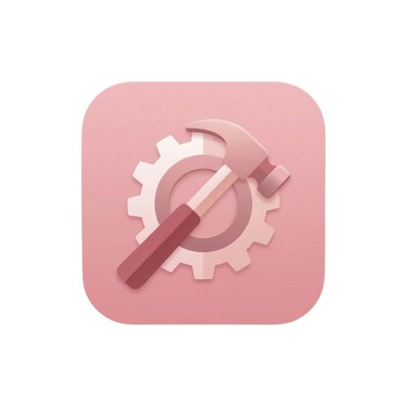
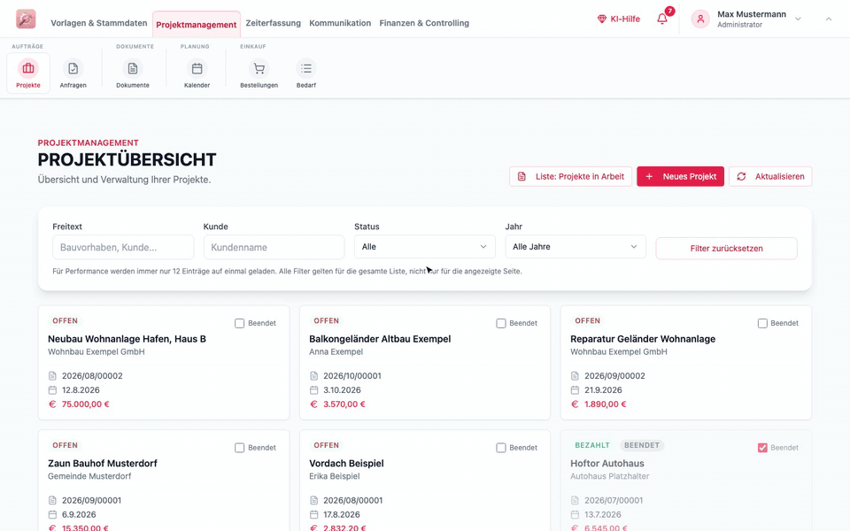
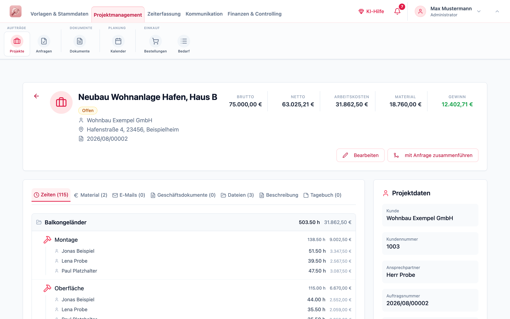
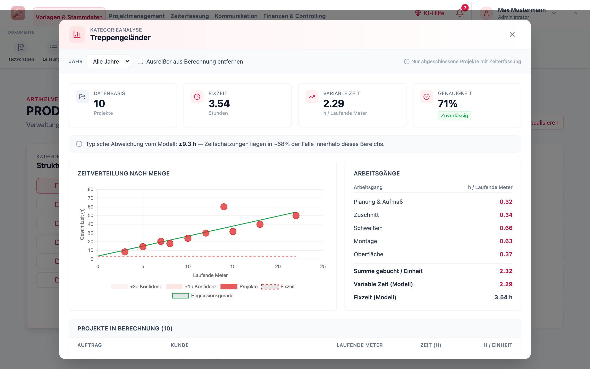
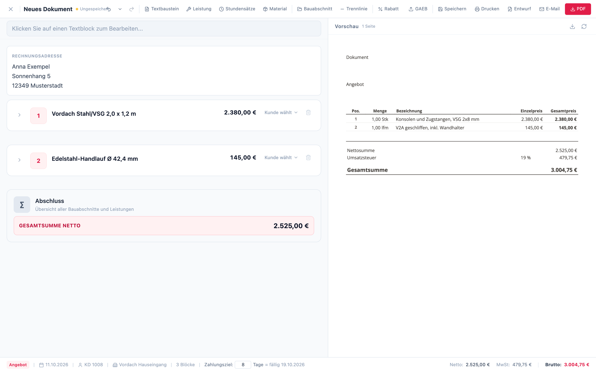
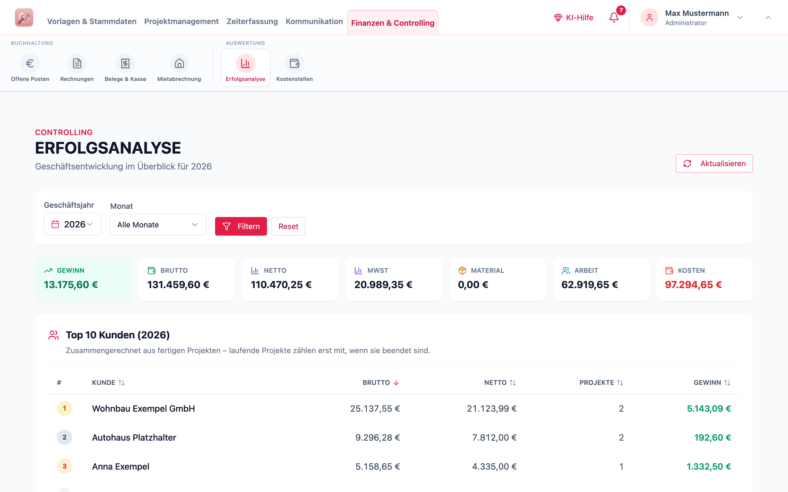
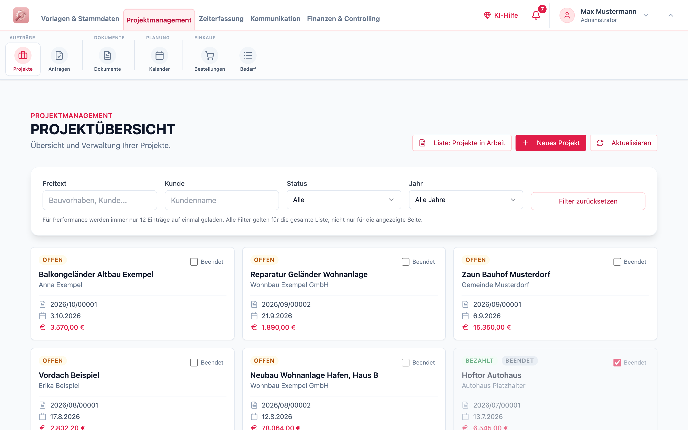
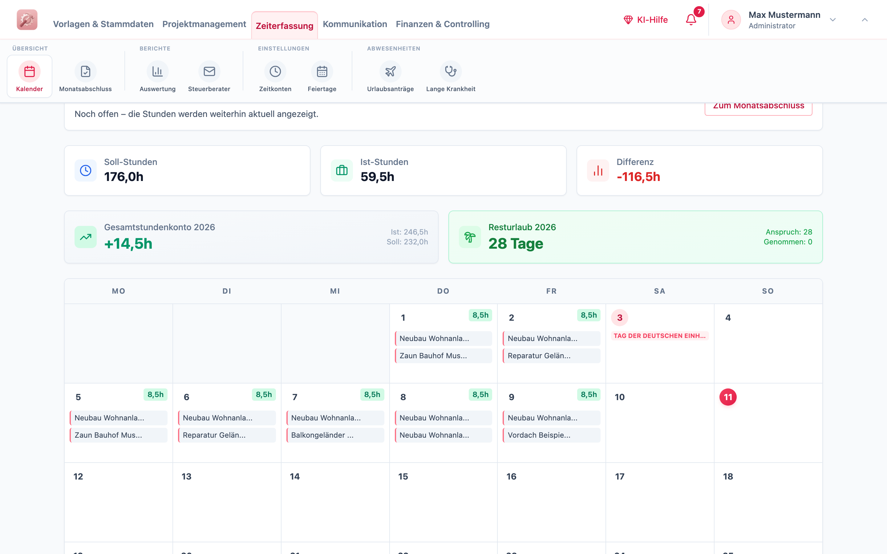
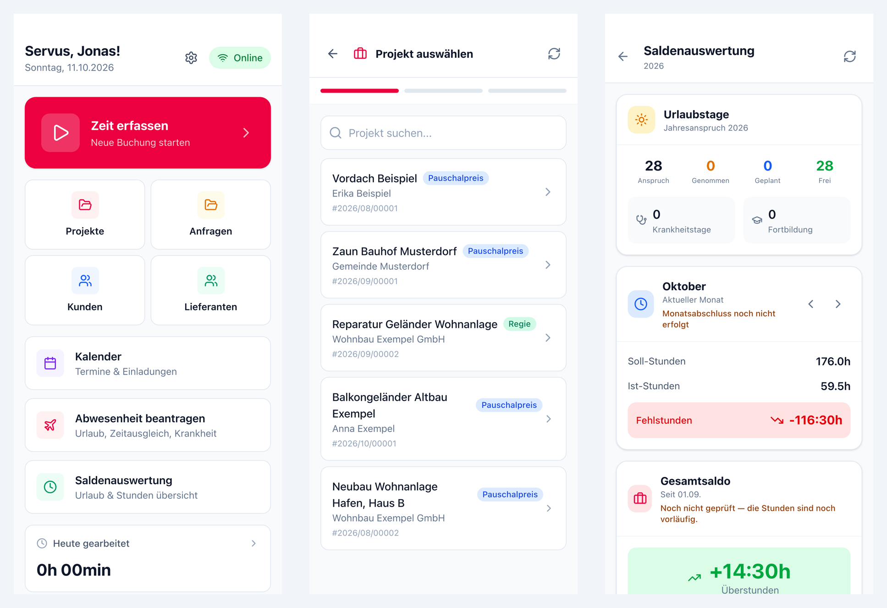
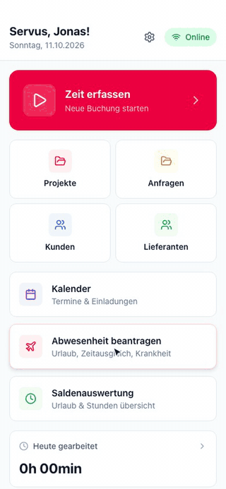

<p align="center">
  
</p>

<h1 align="center">Handwerkerprogramm</h1>

<p align="center">
  Open-Source-ERP für Handwerksbetriebe: Angebote, Projekte, Zeiterfassung, Einkauf und Rechnungen in einer Anwendung.
</p>

<p align="center">
  <a href="LICENSE"></a>
  
  
  
  
</p>

<p align="center">
  <a href="assets/video/rundgang-desktop.mp4">
    
  </a>
  <br />
  <sub>Rundgang mit Demo-Daten: Projekt mit Nachkalkulation, Zeitanalyse je Produktkategorie, Angebot im Dokumenteditor, Erfolgsanalyse. <a href="assets/video/rundgang-desktop.mp4">Als MP4</a></sub>
</p>

## Worum es geht

Entstanden ist das Programm im Metallbaubetrieb meines Vaters. Es deckt den Ablauf eines Handwerksbetriebs von der Kundenanfrage bis zur bezahlten Schlussrechnung ab und rechnet dabei laufend nach, ob ein Auftrag Geld verdient. Die Oberfläche spricht die Sprache der Werkstatt, nicht die der Buchhaltung.

Es läuft selbst gehostet im Firmennetz, die Daten bleiben im Betrieb. Die Mitarbeiter stempeln über eine Web-App auf dem Handy, die auch ohne Netz funktioniert.

## Ausprobieren

Voraussetzung ist [Docker](https://www.docker.com/products/docker-desktop/), unter Windows zusätzlich Git Bash oder WSL. Das Skript baut das Image, startet Datenbank und App als eigenes Compose-Projekt `erp-demo` und füllt sie mit einem erfundenen Metallbaubetrieb (24 Projekte, Zeitbuchungen, Rechnungen, Zeitkonten).

```bash
git clone https://github.com/Winfo2024Kuhn/ERP-System-fuer-Handwerksbetriebe.git
cd ERP-System-fuer-Handwerksbetriebe
scripts/demo/demo-starten.sh
```

Danach `http://localhost:8080` öffnen und gleich registrieren: Der erste Benutzer wird Admin, und die App ist im lokalen Netz erreichbar. Die Handy-App liegt unter `/zeiterfassung`, angemeldet wird per QR-Code aus der Mitarbeiterverwaltung. Damit ein echtes Handy ihn öffnen kann, beim Start die Netzwerkadresse des Rechners mitgeben: `ZEITERFASSUNG_URL=http://192.168.1.20:8080 scripts/demo/demo-starten.sh`. Ohne HTTPS laufen Stempeln und Ansehen, Offline-Modus und Push-Nachrichten aber nicht. Alles wieder entfernen: `docker compose -p erp-demo down -v`.

## Funktionen

| Bereich | Was das Programm macht |
| --- | --- |
| **Anfragen** | Anfragen aus dem Website-Formular mit Spamfilter, Fotos und Notizen. Wird daraus ein Auftrag, wandern Notizen und Bilder ins Bautagebuch. |
| **Angebote und Rechnungen** | Dokumenteditor aus Bausteinen mit Live-PDF. Angebot, Auftragsbestätigung, Abschlags-, Teil- und Schlussrechnung, Gutschrift, Storno. GAEB-Import, ZUGFeRD/XRechnung nach EN 16931, digitale Angebotsannahme mit Bestätigungscode per E-Mail. Gebuchte Rechnungen sind GoBD-konform gesperrt. |
| **Projekte** | Laufende Nachkalkulation aus Arbeitszeit, Material, Lagerartikeln und zugeordneten Eingangsrechnungen. Bautagebuch, Dateien, E-Mails und Dokumente je Projekt. CAD- und Excel-Dateien öffnen per Klick im passenden Programm. |
| **Kalkulation** | Leistungskatalog mit Produktkategorien. Aus abgeschlossenen Projekten berechnet eine lineare Regression Fixzeit und Zeit pro Einheit, aufgeteilt nach Arbeitsgang. |
| **Zeiterfassung** | Web-App fürs Handy: stempeln auf Projekt, Kategorie und Arbeitsgang, offline mit späterem Abgleich. Zeitkonten, Urlaub und Abwesenheit, Feiertage, Monatsabschluss, Export für die Lohnabrechnung (DATEV LODAS). |
| **Einkauf** | Bedarf, Bestellanfragen und Bestellungen. Lieferantenrechnungen und Lieferscheine kommen aus dem Postfach, werden erkannt (ZUGFeRD-XML, sonst KI) und auf Projekte und Kostenstellen verteilt. |
| **Kommunikation** | E-Mail-Zentrale mit mehreren Postfächern und Sichtbarkeit nach Abteilung, Textvorlagen, Signaturen, Abwesenheitsnotiz, FRITZ!Box-Anrufliste. Beiträge für den Bereich „Aktuelles“ auf der Firmen-Website. |
| **Finanzen** | Erfolgsanalyse mit Vorjahresvergleich, offene Posten und Mahnwesen, Kasse und Belege, Kostenstellen, Nebenkostenabrechnung für vermietete Objekte. |

## Oberfläche

<table>
  <tr>
    <td width="50%"><br /><sub>Projekt mit Nachkalkulation: Stunden nach Arbeitsgang und Mitarbeiter, Gewinn laufend gerechnet</sub></td>
    <td width="50%"><br /><sub>Zeitanalyse je Produktkategorie: Fixzeit und Stunden pro Meter aus abgeschlossenen Projekten</sub></td>
  </tr>
  <tr>
    <td><br /><sub>Dokumenteditor: Leistungen aus dem Katalog, PDF-Vorschau daneben</sub></td>
    <td><br /><sub>Erfolgsanalyse: Umsatz, Kosten und Gewinn je Jahr und Kunde</sub></td>
  </tr>
  <tr>
    <td><br /><sub>Projektübersicht mit Status, Auftragsnummer und Auftragswert</sub></td>
    <td><br /><sub>Zeiterfassung im Büro: Soll, Ist und Stundenkonto je Mitarbeiter</sub></td>
  </tr>
</table>

### Zeiterfassung auf dem Handy

<p align="center">
  
  &nbsp;
  <a href="assets/video/rundgang-mobil.mp4"></a>
</p>

## Installation

**Im Betrieb (Windows-PC oder Linux-Server):** Ordner [`deployment/docker-server`](deployment/docker-server) auf den Rechner kopieren, unter Windows `Einrichten.cmd` doppelklicken, unter Linux `sudo ./einrichten.sh` ausführen. Das richtet PostgreSQL, das ERP, einen Updater und eine Netzsperre ein. Der Updater sichert jede Nacht um 2 Uhr die Datenbank (auf Wunsch zusätzlich mit den Dateien auf eine externe Festplatte oder in einen Cloud-Ordner), spielt um 3 Uhr neue Versionen ein, sichert davor noch einmal und rollt bei Fehlern zurück. Die Netzsperre lässt das ERP ins Internet (Mail, KI, Website), aber nicht ins übrige Firmennetz. Das ERP selbst kommt als fertiges Image aus der GitHub Container Registry. Anleitung: [EINRICHTEN.md](deployment/docker-server/EINRICHTEN.md).

**Zur Entwicklung:** Java 25, Node.js 20.19 oder neuer und Docker für die Datenbank (PostgreSQL 16).

```bash
docker run -d --name erp-dev-pg -p 127.0.0.1:5432:5432 -e POSTGRES_DB=kalkulationsprogramm_db -e POSTGRES_USER=erp_user -e POSTGRES_PASSWORD=erp_dev postgres:16
cp src/main/resources/application-local.properties.example src/main/resources/application-local.properties
./mvnw spring-boot:run
```

Die Datenbank-Zugangsdaten (hier `erp_user` / `erp_dev`) kommen in die `application-local.properties` (nicht versioniert). Eine leere Datenbank bekommt beim ersten Start Basis-Schema und alle Migrationen automatisch, das Backend läuft dann auf Port 8080. Später reicht `docker start erp-dev-pg`. Die Oberflächen laufen mit Hot Reload über `npm ci && npm run dev` in `react-pc-frontend` und `react-zeiterfassung`. Details, Zugriff von unterwegs (Tailscale, Cloudflare Tunnel) und Betrieb: [docs/INSTALLATION.md](docs/INSTALLATION.md).

## Technik

| Schicht | Umsetzung |
| --- | --- |
| Backend | Java 25, Spring Boot 4.1, Spring Security, JPA/Hibernate, Flyway |
| Datenbank | PostgreSQL 16 |
| Desktop | React 19, TypeScript, Vite, Tailwind CSS |
| Handy | React-PWA mit IndexedDB für den Offline-Betrieb, Web-Push |
| Dokumente | OpenPDF, PDFBox, Mustang (ZUGFeRD/XRechnung) |
| E-Mail | Jakarta Mail (IMAP und SMTP) |
| KI | Google Gemini (freiwillig) für Belegerkennung, Hilfe-Chat, Textvorschläge und Spracheingabe |
| Betrieb | Ein Docker-Image mit Backend und beiden Oberflächen, nächtliches Update mit Sicherung und Rollback |

Backend und beide Oberflächen laufen als eine Anwendung: Die Frontends werden nach `src/main/resources/static` gebaut und von Spring Boot ausgeliefert.

```text
src/main/java/.../kalkulationsprogramm/   REST-Controller, Services, Domain, Repositories
src/main/resources/db/postgresql/         Basis-Schema und Flyway-Migrationen
react-pc-frontend/                        Desktop-Oberfläche
react-zeiterfassung/                      Handy-App (PWA)
deployment/docker-server/                 Einrichtung und Updater für den Betrieb
scripts/demo/                             Demo-Start und Demo-Daten
docs/                                     Fachliche und technische Dokumentation
```

## Datenschutz und KI

- Das System läuft im eigenen Netz. Kunden-, Mitarbeiter- und Zeitdaten bleiben im Betrieb.
- Die KI-Funktionen sind freiwillig. Mit hinterlegtem Gemini-Schlüssel schicken sie Belege, Texte und Sprachaufnahmen an die Google-Gemini-API. Für personenbezogene Daten die kostenpflichtige API mit Auftragsverarbeitungsvertrag nutzen, dort werden Anfragen nicht zum Training verwendet.
- Ohne Schlüssel bleiben die KI-Funktionen aus: KI-Knöpfe sind gesperrt oder ausgeblendet, und es gehen keine Belege oder Texte an Google. Alle übrigen Abläufe funktionieren ohne KI. Pflicht in der Ersteinrichtung ist nur der Mailserver; den Schlüssel trägt ein Admin bei Bedarf später unter Einstellungen → KI-Funktionen ein.
- Für die Zeitdaten der Mitarbeiter gelten die üblichen DSGVO-Pflichten. Details: [GOBD_COMPLIANCE.md](docs/GOBD_COMPLIANCE.md), [SECURITY.md](SECURITY.md).

## Dokumentation

[Installation](docs/INSTALLATION.md) · [Architektur](docs/ARCHITEKTUR_UEBERSICHT.md) · [API](docs/API_REFERENZ.md) · [Angebote](docs/ANGEBOTSWESEN.md) · [Rechnungen](docs/RECHNUNGSWESEN.md) · [E-Rechnung](docs/ZUGFERD_E_INVOICING.md) · [Einkauf](docs/BESTELLWESEN.md) · [Zeiterfassung](docs/ZEITERFASSUNG_WORKFLOWS.md) · [GoBD](docs/GOBD_COMPLIANCE.md)

## Mitmachen

Issues und Pull Requests sind willkommen. Backend-Änderungen brauchen Tests (JUnit 5, Mockito), Texte in der Oberfläche sind deutsch und in Alltagssprache. Pull Requests gegen `main` laufen durch die CI.

## Lizenz

[AGPL v3](LICENSE). Nutzen, ändern und weitergeben ist erlaubt, auch im eigenen Betrieb. Wer eine geänderte Version als Dienst für andere anbietet, muss den Quellcode offenlegen. Eine kommerzielle Lizenz ohne diese Pflicht gibt es auf Anfrage. Verwendete Bibliotheken: [THIRD-PARTY-LICENSES.md](THIRD-PARTY-LICENSES.md).
